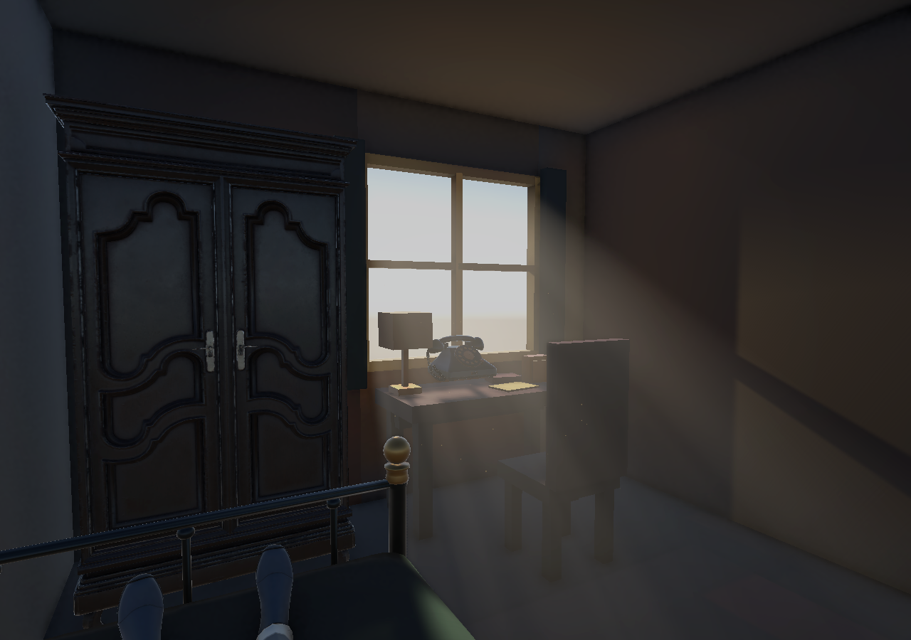

# Tutorial 窗户玻璃与体积光

## 初始窗光配置

- `PB_WindowGlass` 使用独立 `M_Tutorial_WindowGlass`：URP Lit 透明、Alpha 0.12、Smoothness 0.92、非金属、保留高光。关闭玻璃投影及静态遮挡/GI 标志；墙和窗框继续投影。
- `Directional Light` 是穿窗主光：旋转 `(25,195,0)`，强度 1.8，暖白，低阴影偏移。原 `Window_CoolFillLight` 保留为强度 1.5 的轻微补光，不贡献体积散射。
- `Tutorial_WindowLighting` 上的 Volume 引用独立 `Tutorial_WindowAtmosphere`。主光参与体积散射；密度 0.25，散射 1，方向性 0.45，96 步，1 次模糊，最大距离 12 米。
- `Tutorial_WindowReflection` 是覆盖房间的 128 像素 HDR 反射探针，启用 Box Projection；通过 Custom 模式引用离线烘焙的 cubemap，避免反射绑定依赖尚未生成的整场景 LightingDataAsset。
- `Tutorial_WindowDust` 是每秒约 7 粒、最多 90 粒的低速浮尘，具有近相机淡出、与不透明物体相交软化、出生/死亡淡出。
- Volume 内另有低强度 Bloom。没有改动白盒生成器。

## 资源与隔离

配置资源位于 `Assets/Tutorial/Lighting/`。
`Tutorial_WindowRenderer.asset` 从 PC Renderer 复制，保留 SSAO，额外添加体积光功能。它注册在 PC/Mobile 管线的 renderer index 1；两个管线的默认 renderer 仍为 index 0，只有 Tutorial 相机选择 index 1。没有修改共享 DefaultVolumeProfile。

体积光包以 embedded package 存在于 `Packages/com.cqf.urpvolumetricfog`：

- 上游：https://github.com/CristianQiu/Unity-URP-Volumetric-Light
- 版本：0.5.91
- 固定提交：354ebc5b6ed3c2c40dc9797c813b56d5da213c4e
- 保留 MIT 许可证，来源见包内 `UPSTREAM.txt`。源码未经修改。

体积雾安排在透明物体之前渲染，以便玻璃高光和浮尘覆盖其上。这个开源方案对透明物体的雾混合仍有近似误差，尤其不适合多层透明玻璃；当前为单个薄盒窗户，不做真实折射或彩色透射阴影。PC 已验证，移动设备的性能和显示效果未测。

## 手动调节

1. 光束方向、落点：调整 `Directional Light` 旋转；阴影偏移保持较低，避免细窗框失去遮挡。
2. 光束亮度：优先在 `Tutorial_WindowAtmosphere` 调整 Scattering 或 Density。当前主光散射已为 1；减少 Density 可以让光束更淡。
3. 玻璃存在感：调材质 Alpha 和 Smoothness。玻璃无需自发光。
4. 反射：更改房间或光照后，运行 `Tools → Detective Game → Bake Tutorial Window Reflection`。
5. 性能：先将 Max Steps 从 96 调至 64；不要为了提亮光束开启其他灯的体积贡献。

`Tools → Detective Game → Configure Tutorial Window Lighting` 可重复应用初始配置，会覆盖以上手动调节值；没有导入时自动执行的逻辑。此工具与原白盒生成器独立。

## 验证

- Unity 6000.5.9f1 / URP 17.5 下成功编译；Lit、体积光、深度降采样、浮尘四个 Shader 均支持且没有 Shader 编译错误。
- 透明材质队列 3000、ZWrite 关闭、玻璃投影关闭；反射 cubemap 已绑定。
- 保存并重新加载 Tutorial 后重复验证通过：反射 cubemap 引用、透明材质和渲染功能均保留，Console 错误数仍为 0。
- 配置工具重复运行没有重复的体积光功能；原场景对象未被删除或重命名。
- 进入 Play Mode 检查开场阶段，以及通过控制器的 CompleteOpening 进入 Finished 阶段。浮尘正常模拟（抽样时 61 粒），Console 错误数为 0。
- 用运行时临时相机检查房间全景、近窗斜视及光束内部。相机使用相同 Tutorial 渲染器；临时相机已经销毁，编辑器已退出 Play Mode。没有做目标设备帧率基准测试或完整开场输入流程回归。

运行时渲染样图：

## 窗外轻微柔化（后续更新）

`M_Tutorial_WindowGlass` 已改为 `DetectiveGame/Tutorial/Window Glass`，保留 URP PBR 高光、反射探针和透明混合。原有 Glass Tint、Alpha、Smoothness 保留用户当前值；添加以下参数：

- **Blur Amount**：0 为关闭，1 为完整应用模糊结果。当前默认 0.6。
- **Blur Radius (pixels at 1080p)**：模糊采样最远半径，以 1080p 为参考自动适配渲染分辨率。当前默认 4，范围 0–12；半径为 0 同样关闭效果。
- **Glass Tint (A = Opacity)**：A 仍是表面不透明度，和模糊强度独立。本次保留用户设置的约 0.945；如果想更明显看见外景，建议手动将 A 降至 0.12–0.25，再调模糊。

实现使用 5×5 二项式权重近似高斯核，只对玻璃覆盖的像素采样背景；通过深度剔除比玻璃更近的窗框和家具，减少前景颜色向玻璃内扩散。使用模糊背景与清晰背景的颜色差修正透射项，避免用不透明快照直接覆盖原来的体积光和玻璃反光。相机已开启 Opaque Texture 和 Depth Texture。

这是屏幕空间近似，不是物理透射散射：只包含不透明物体和天空，不会模糊后绘制的透明物体；视野外背景不可采样。半径较大时会受背景纹理分辨率和离散采样影响，当前方案以轻微模糊为目标，不适合直接调成极强磨砂。当前窗外主要是平滑天空，实际可辨认的模糊变化较小。

推荐外观：

- 轻微高斯柔化：Amount 0.4–0.65，Radius 3–5，当前采用。
- 较柔和的半磨砂：Amount 0.8–1，Radius 8–10；这是现有算法的较强设置，强磨砂应另做多级模糊。
- 旧玻璃：轻微高斯加低频折射扭曲，更有年代感；扭曲功能尚未实现。

验证：Shader 编译和实际离屏 GPU 渲染通过，Console 无错误。临时室外棋盘格、临时 Alpha 0.12 对比中，默认模糊相对关闭的平均红通道差为 0.01287，强模糊为 0.07195；窗框区域差约 0.000118，符合只模糊背景的预期。测试结束已销毁临时物体并恢复原材质，未把棋盘格或测试透明度保存到场景。未测目标设备 GPU 帧耗。
